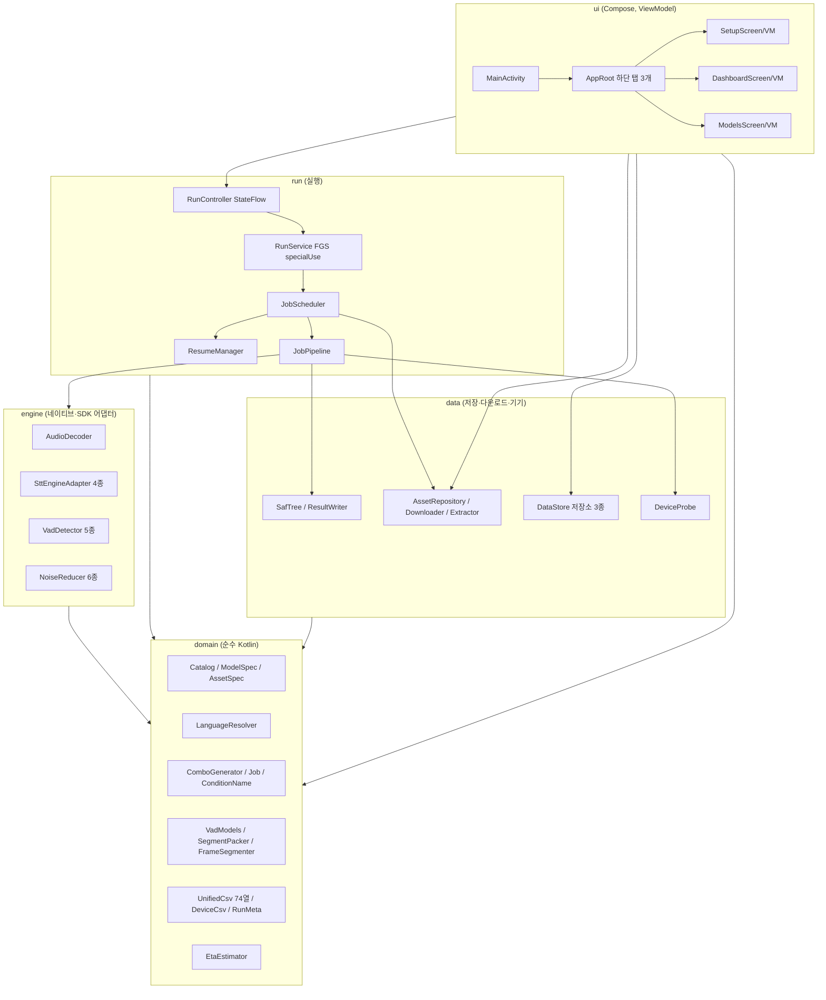
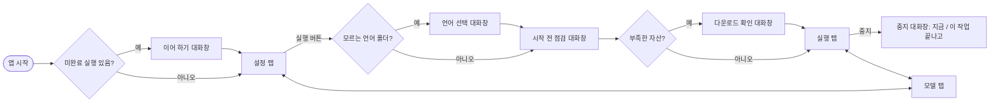
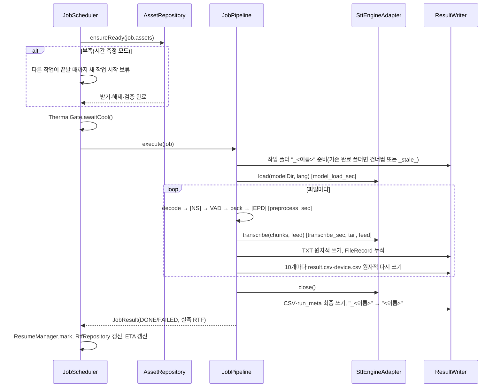

# 4단계 — 아키텍처 및 상세 설계 (google_stt 재작성 v4.0.0)

- 파일: `docs/AI_analyze/04_아키텍처_상세설계_20261105.md`
- 작성: 2026-11-05 (Android Application 개발 공통 지침 2장 4단계)
- 입력: 1단계 분석(재사용 판정 A/B/C/D), 2단계 요구사항(FR-01~10, NFR-01~14), 3단계 기술 검증(T1~T8, 결정 D13~D21)
- 이 문서의 범위: 구조(패키지·계층), 클래스 책임과 핵심 시그니처, 데이터 모델, 화면 흐름·와이어프레임, 실행 순서(시퀀스), 상태 기계, 동시 실행·취소 규칙, 저장 형식(폴더·CSV), 빌드 구성.
- 범위 밖: 작업 분할·일정(5단계), 테스트 케이스·오류 처리 표(6단계), 실제 코드(7단계).
- 표기: 판정 **A** 그대로 · **B** 손질 후 재사용 · **C** 재작성 · **D** 제거 · **N** 신규

---

## 0. 설계 원칙(요구사항에서 도출)
1. **순수 Kotlin 도메인 분리**: 카탈로그·언어 판정·조합 생성·조건 이름·CSV 열·ETA 는 `android.*` 를 import 하지 않는다 → JVM 단위 테스트(NFR-12).
2. **Activity 와 실행 분리**: 실행은 포그라운드 서비스 + 스케줄러, 화면은 StateFlow 만 구독(1단계 위험 2).
3. **열 정의 한 곳**: CSV 열 이름과 값 계산을 `(이름, 계산식)` 목록 하나로 둔다(1단계 위험 8, 과거 열 밀림 사고).
4. **취소에 반응**: `CancellationException` 을 삼키지 않고, 공급 대기는 `delay()`/인터럽트 가능 대기(1단계 위험 3·4).
5. **원자적 쓰기**: 결과 파일은 임시 파일 → 이름 바꾸기(1단계 위험 7).
6. **서버 규칙 고정**: 결과 폴더·조건 이름·74열 CSV·언어 낱말·VAD 값은 서버 v8.8.0 과 같게(NFR-14). 서버 코드는 읽기만 한다.
7. **단순성**: 추가 라이브러리는 Compose·DataStore·Commons Compress 만. DI 프레임워크·Room·OkHttp·WorkManager 는 쓰지 않는다(3단계 T3, 이 문서 11장 결정 요청).

---

## 1. 전체 구조

### 1-1. 계층도

- 의존 방향: `ui → run/data → engine → domain`. `domain` 은 아무것도 의존하지 않는다.
- 객체 생성: `SttApp : Application` 안의 `AppContainer` 가 저장소·컨트롤러를 1개씩 만들어 넘긴다(수동 DI).

### 1-2. 모듈 구성
- Gradle 모듈은 **`:app` 하나** 유지(결정 요청 Q9). 계층은 패키지로 나누고, `domain` 의 `android.*` import 금지는 9단계 코드 리뷰 점검 항목 + 간단한 grep 검사로 지킨다.
- `applicationId`/`namespace` 는 `com.example.google_stt` 유지(Q11). versionName 4.0.0, versionCode 12.

### 1-3. 패키지·파일 목록과 출처
| 패키지 | 파일(클래스) | 판정·출처 | 책임 |
|---|---|---|---|
| (루트) | `SttApp.kt`, `AppContainer.kt` | N | Application, 객체 생성·보관 |
| `domain/catalog` | `Language.kt`, `ModelSpec.kt`, `AssetSpec.kt`, `Catalog.kt` | B ← `SherpaModels.kt`·`SttModels.kt` | 모델 20개·자산 정의(언어·URL·크기·SHA256 포함) |
| `domain/lang` | `LanguageResolver.kt` | B ← `io/AudioInput.kt`(`INPUT_LANG_WORDS`, `planLanguageFolders`) | 폴더 이름 → 언어 |
| `domain/vad` | `VadModels.kt`, `VadTypes.kt`, `FrameSegmenter.kt`, `SegmentPacker.kt` | A(VadTypes 는 `SileroVadProcessor.kt` 에서 분리 이동) | VAD 프리셋 22+CUSTOM, 구간화·조각 묶기 |
| `domain/condition` | `RunOptions.kt`, `ConditionName.kt` | B ← `MainActivity` 조건 조합·`Selections.kt` | 조건 이름 규칙 |
| `domain/plan` | `Job.kt`, `ComboGenerator.kt`, `PlanCsv.kt`, `PlanProgress.kt` | B ← `plan/PlanModels.kt` | 조합 생성·순서·CSV 입출력·진행 기록 |
| `domain/csv` | `CsvColumn.kt`, `CsvFormat.kt`, `UnifiedCsv.kt`, `DeviceCsv.kt`, `RunMeta.kt`, `FileRecord.kt` | C ← `SttTelemetry.kt`(SttRow·99열) | 74열·보조 CSV·run_meta 직렬화 |
| `domain/eta` | `EtaEstimator.kt`, `RtfKey.kt` | N | 예상 시간 |
| `domain/epd` | `SpeechEpd.kt` | A | ML Kit 61초 결함 회피 분할 |
| `engine/audio` | `AudioDecoder.kt` | A | 16 kHz mono PCM16 디코딩·리샘플 |
| `engine/stt` | `SttEngineAdapter.kt`, `SttAdapterFactory.kt`, `SherpaOfflineAdapter.kt`, `SherpaStreamingAdapter.kt`, `VoskAdapter.kt`, `MlKitAdapter.kt`, `GoogleSttSession.kt`, `PcmFeeder.kt`, `SttConstants.kt`, `SttUtil.kt` | B ← 같은 이름 Transcriber 들, A(PcmFeeder·상수·유틸) | 엔진 호출 |
| `engine/vad` | `VadPipeline.kt`, `VadDetectorFactory.kt`, `SileroVadDetector.kt`, `PyannoteVadDetector.kt`, `FsmnVadDetector.kt`, `FireRedVadDetector.kt`, `TenVadDetector.kt`, `KaldiFbank.kt` | B ← `vad/*`, `SileroVadProcessor.kt`, A(KaldiFbank — `engine/denoise` 의 Fft 를 써서 domain 에 둘 수 없음, 2026-11-05 변경) | VAD 추론(모델 경로 주입), FSMN·FireRed 용 80차 fbank |
| `engine/denoise` | 기존 5파일 | A(기본 끔) | 노이즈 저감 |
| `data/saf` | `SafTree.kt`, `OutputLayout.kt`, `ResultWriter.kt`, `AudioScanner.kt` | C ← `io/ResultStore.kt`, B ← `AudioInput.collectAudio` | 폴더 탐색·원자적 쓰기·경로 규칙 |
| `data/assets` | `AssetStore.kt`, `AssetDownloader.kt`, `ArchiveExtractor.kt`, `Sha256.kt`, `AssetImporter.kt`, `AssetRepository.kt` | N | 다운로드·해제·검증·가져오기·상태 |
| `data/prefs` | `SettingsRepository.kt`, `LangMemoryRepository.kt`, `RtfRepository.kt` | C ← `plan/PlanState.kt` | DataStore |
| `data/device` | `DeviceProbe.kt`, `AppLog.kt` | B ← `SttTelemetry` 의 기기 조회 부분 | 배터리·발열·메모리·CPU·네트워크·로그 |
| `run` | `RunController.kt`, `RunService.kt`, `JobScheduler.kt`, `JobPipeline.kt`, `PipelineSteps.kt`, `ThermalGate.kt`, `MemLogger.kt`, `ResumeManager.kt`, `RunState.kt` | C ← `BatchRunner.kt`, `plan/PlanRunner.kt`, `PlanState.newExits` | 실행 |
| `ui` | `MainActivity.kt`, `AppRoot.kt`, `theme/*`, `setup/*`, `dashboard/*`, `models/*`, `dialogs/*`, `components/*` | C ← `MainActivity.kt`, D ← `ui/VadUi·EpdUi·NoiseUi·PlanUi·UiUtils`, res/layout | Compose 화면 |

- 제거(D): `ui/VadUi.kt`, `EpdUi.kt`, `NoiseUi.kt`, `PlanUi.kt`, `UiUtils.kt`, `res/layout/*.xml`, `MANAGE_EXTERNAL_STORAGE` 관련 코드, 날짜 폴더 규칙(D2).
- 이동 원칙: B 파일은 `git mv` 로 옮긴 뒤 수정 → 이력 유지. 파일 안 함수·변수 순서는 원본 순서를 지킨다(코드 규칙 2). 패키지 이동표(부록 B)를 Beyond Compare 비교용으로 함께 둔다.

---

## 2. 도메인 데이터 모델(domain, 순수 Kotlin)

### 2-1. 카탈로그
```kotlin
enum class Language(val code: String, val reqLang: String) { KO("ko", "ko-KR"), EN("en", "en-US") }
enum class LangSupport { KO_ONLY, EN_ONLY, MULTI }
enum class Runtime { SHERPA_OFFLINE, SHERPA_STREAMING, VOSK, MLKIT }      // whisper.cpp 는 v4.1.0 에 WHISPER_CPP 추가
enum class Commercial { ALLOWED, CONDITIONAL }

data class ModelSpec(
    val engine: String,          // 결과 엔진 이름(`_` 금지) 예: whisper-base
    val model: String,           // 결과 모델 이름: sherpa-int8 / vosk / basic
    val runtime: Runtime,
    val family: String,          // sherpa 설정 분기용(whisper, qwen3asr, omnilingual, nemotron, zipformer, sensevoice, parakeet, moonshine, vosk, mlkit)
    val assetId: String?,        // ML Kit 은 null(시스템 관리)
    val maxChunkSec: Int?,       // 오프라인 조각 상한(29/30/39/15/30/30/25), 스트리밍·Vosk 는 null
    val langSupport: LangSupport,
    val license: String,
    val commercial: Commercial,
    val displayName: String,
)

enum class AssetKind { STT_MODEL, VAD_MODEL }
enum class ArchiveType { TAR_BZ2, ZIP, NONE }
data class AssetFile(val pathInArchive: String, val target: String, val sha256: String?)
data class AssetSpec(
    val id: String,              // 예: sherpa-onnx-whisper-base
    val kind: AssetKind,
    val url: String,             // 원본 1개(GitHub/alphacephei/raw github)
    val archive: ArchiveType,
    val archiveBytes: Long?,     // 3단계 실측값
    val archiveSha256: String?,  // PC 1회 계산 후 매니페스트에 고정(없으면 "미검증")
    val files: List<AssetFile>,  // 풀어서 남길 파일만(나머지는 버림)
    val license: String,
)
object Catalog { val models: List<ModelSpec>; val assets: Map<String, AssetSpec>; fun modelsFor(lang: Language): List<ModelSpec> }
```
- 해시 값은 코드에 직접 쓰지 않고 `assets/asset_manifest.json` 에서 읽어 `AssetSpec` 에 합친다(PC 스크립트로 갱신 → 코드 수정 없이 해시 교체).
- 언어 전용 판정은 `ModelSpec.langSupport` 한 곳(기존 `PlanCheck.KO_ONLY/EN_ONLY`·MainActivity 중복 제거).

### 2-2. 입력·언어
```kotlin
enum class LangSource { AUTO_SUBFOLDER, AUTO_ROOT, REMEMBERED, ASKED }
data class LangFolder(val name: String, val docId: String, val lang: Language?, val source: LangSource)
object LanguageResolver {
    val WORDS: Map<Language, List<String>>            // 서버 INPUT_LANG_WORDS 와 동일
    fun resolve(folderName: String): Language?        // 같거나 `_<낱말>` 로 끝남
    fun plan(rootName: String, children: List<Pair<String, String>>, memory: Map<String, Language?>): LangPlan
}
data class LangPlan(val folders: List<LangFolder>, val unknown: List<LangFolder>, val splitByLang: Boolean)
```
- `splitByLang=false` 는 FR-01-03(입력 폴더 자체가 kr/en 인 경우, 결과에 언어 폴더를 만들지 않음).
- 모르는 폴더(`unknown`)는 실행 전 대화창(4-4)에서 고르고 `LangMemoryRepository` 에 docId 로 저장, 건너뛰기는 `null` 로 저장.

### 2-3. 조건·조합
```kotlin
enum class SegMode { ENGINE_MAX, SEG10 }
enum class FeedChoice(val delayMs: Long?) { NONE(null), REALTIME(100), D50(50), D30(30), D20(20), D10(10) }
data class RunOptions(val seg: SegMode, val feed: FeedChoice, val ns: NsChoice, val epd: EpdChoice)   // NsChoice/EpdChoice 는 OFF 기본

object ConditionName {
    // [NS_<ns>_]<VAD 토큰>[_SEG10][_EPD_<epd>][_FEED_<feed>]
    fun build(vad: VadSelection, opt: RunOptions, runtime: Runtime): String
}
data class Job(
    val lang: LangFolder, val model: ModelSpec, val vad: VadSelection, val opt: RunOptions,
) {
    val condition: String            // ConditionName.build(...)
    val resultDirName: String        // "<engine>_<model>_<condition>"
    val key: String                  // "<lang 폴더>/<resultDirName>" — 이어 하기 식별자
}
data class ComboResult(val jobs: List<Job>, val excluded: List<Pair<Job, String>>)   // 제외 사유(언어 전용·Feed 불가)
object ComboGenerator { fun generate(plan: LangPlan, models: List<ModelSpec>, vads: List<VadSelection>, opts: List<RunOptions>): ComboResult }
```
- **Feed 토큰 규칙(신규 설계)**: 2단계 D4 "사용하면 조건 이름에 반영"을 구체화. 스트리밍·Vosk 에서 Feed 를 고르면 `_FEED_REALTIME`, `_FEED_D50` … 를 붙인다. 오프라인(해당 없음)·ML Kit(REALTIME 고정)·NONE 은 토큰 없음. → v2.4.1 에서 발견한 "Feed 가 이름에 없어 결과가 덮어써짐" 문제 해소.
- 순서 규칙(FR-04-03): 언어 폴더 순 → 그 안에서 오프라인 작업 먼저, 스트리밍·Vosk, 마지막 ML Kit → 같은 모델끼리 묶어 모델 적재 횟수 최소화.
- 조합 수 예: kr 13 + en 15 모델 × VAD 22 = 616(현 견본과 동일).

### 2-4. 결과 기록
```kotlin
data class FileRecord(          // 파일 1개 처리 결과 — 74열·보조 CSV 의 공통 원천
    val runId: String, val startedAt: String, val job: Job, val relDir: String, val file: String,
    val audio: AudioInfo, val timings: Timings, val stt: SttOutcome, val vad: VadSummary?,
    val device: DeviceSample, val workers: Int, val modelLoadSec: Double?, val note: String,
)
class CsvColumn<T>(val name: String, val value: (T) -> String)
object UnifiedCsv { val columns: List<CsvColumn<FileRecord>> }   // 74개, 순서 = stt_common.STT_CSV_HEADER
object DeviceCsv  { val columns: List<CsvColumn<FileRecord>> }   // 7-3 표
object RunMeta    { fun rows(ctx: RunMetaInput): List<Pair<String, String>> }
```
- 헤더와 값이 같은 목록에서 나오므로 열 밀림이 구조적으로 불가능. 단위 테스트가 `UnifiedCsv.columns.map{it.name}` 을 서버 헤더 사본(골든 목록)과 비교한다.

### 2-5. 예상 시간
```kotlin
enum class RtfSource { MEASURED, MEASURED_MODEL, CALIBRATION, OTHER_DEVICE_REF, NONE }
data class RtfKey(val deviceKey: String, val engine: String, val vadGroup: String, val workers: Int)
data class Estimate(val totalSec: Double?, val perJob: List<Pair<Job, Double?>>, val sources: Map<String, RtfSource>, val unknownJobs: Int)
class EtaEstimator(private val lookup: (RtfKey) -> Pair<Double, RtfSource>?) {
    fun estimate(jobs: List<Job>, audioSecByLang: Map<String, Double>): Estimate
    fun remaining(done: List<JobResult>, pending: List<Job>): Estimate
}
```
- `deviceKey = Build.MODEL + "/" + Build.SOC_MODEL`(API 31+). 다른 기기 값은 `OTHER_DEVICE_REF` 로 별도 표시하고 합계에 넣지 않는다(3단계 D 결정).
- 스트리밍 Feed 사용 시: 음원 길이 × (delayMs/100) + tail 추정. ML Kit: 음원 길이 × 1.0 + 세션 간격.

---

## 3. 엔진·VAD 어댑터(engine)

### 3-1. 단일 STT 어댑터 계약
```kotlin
data class AudioChunk(val pcm: ShortArray, val startSec: Double, val endSec: Double)
data class LoadInfo(val loadSec: Double, val engineVersion: String)
interface SttEngineAdapter : AutoCloseable {
    val spec: ModelSpec
    suspend fun load(modelDir: File?, lang: Language): LoadInfo
    suspend fun transcribe(chunks: List<AudioChunk>, feed: FeedChoice, lang: Language): SttOutcome   // 취소에 반응해야 함
}
object SttAdapterFactory { fun create(spec: ModelSpec, ctx: Context): SttEngineAdapter }
```
| 구현 | 이식 원본 | 바뀌는 점 |
|---|---|---|
| `SherpaOfflineAdapter` | `SherpaOfflineTranscriber`(436줄) | `Context`·공용 폴더 경로 → `modelDir: File` 주입, 4 스레드 유지, 조각마다 `ensureActive()` |
| `SherpaStreamingAdapter` | `SherpaStreamingTranscriber`(223줄) | `Thread.sleep` → `delay()`, `feed=NONE` 이면 대기 없이 최대 속도 공급, 끝 0.5 s 무음·inputFinished 유지 |
| `VoskAdapter` | `VoskTranscriber`(175줄) | 위와 같음 |
| `MlKitAdapter` | `MlKitTranscriber` + `GoogleSttSession` | REALTIME 고정, 세션 한도 35·warm-up·`com.google.android.tts` 안내 유지, `PcmFeeder` 데몬 스레드 유지(인터럽트로 중지) |
- `SttOutcome` 은 기존 형태 유지(text, utterances, status, firstResultMs, tailMs, feedSec, feedMeasured, detectedLang).

### 3-2. VAD
```kotlin
interface VadDetector : AutoCloseable { fun detect(pcm: ShortArray): VadResult }
object VadDetectorFactory { fun create(sel: VadSelection, assets: AssetPaths): VadDetector? }   // NOVAD 는 null
```
- 디텍터 5종의 추론 본문은 그대로. 바뀌는 점은 모델 위치(`assets`/공용 폴더 → `AssetStore` 경로), 그리고 `VadConfig/VadSegment/VadResult` 를 `domain/vad/VadTypes.kt` 로 이동한 import 뿐.
- TEN 은 `.so` 를 APK 에 포함(기존 유지), 적재 실패는 실행 시작 전 점검(4-4 시작 전 점검)에서 드러나게 한다(1단계 "배치 시작 때야 드러남" 해소).

---

## 4. 화면 설계(ui)

### 4-1. 화면 흐름

- 탭 3개(설정·실행·모델)는 `NavigationBar` + `rememberSaveable` 상태로 전환(Navigation 라이브러리 없이, 결정 요청 Q12).

### 4-2. 설정 탭(와이어프레임 — 숫자는 배치 설명용 예시)
```
┌ 폴더 ─────────────────────────────────────┐
│ 입력  Documents/input_sound/scarlett   [변경] │
│       kr → 한국어(자동) 24개 · en → 영어(자동) 30개 │
│ 출력  Documents/output/20261105        [변경][새 폴더] │
└─────────────────────────────────────────────┘
┌ 엔진·모델 ─ [전체] [오프라인] [스트리밍] [상업 조건부] [영어 전용] ┐
│ (칩) whisper-tiny  whisper-base … qwen3asr-0.6b  nemotron3.5-560ms │
│      zipformer-ko [상업 조건부] … google-mlkit                    │
└────────────────────────────────────────────────────┘
┌ VAD ─ [전체] [Silero 8] [pyannote 3] [FSMN 3] [FireRed 3] [TEN 3] [NOVAD] ┐
└────────────────────────────────────────────────────┘
▸ 고급(접힘): 구간 처리(엔진 최대/10초) · Feed(사용 안 함 기본) · 노이즈 저감(사용 안 함) · EPD(사용 안 함)
             실행 목적(시간 측정 = 동시 1 / 정확도만 = 동시 2~3) · 다운로드 Wi‑Fi 전용
┌ 조합 요약 ───────────────────────────────────┐
│ 616개 작업 (제외 n: 언어 전용) · 결과 폴더 이미 있음 0            │
│ 필요한 모델 18개 · 준비됨 12 · 받을 것 6 (3.1 GB, 여유 41 GB)      │
│ 예상 7일 4시간 (실측 9 · 빠른 측정 3 · 미측정 2)  [빠른 측정]      │
└──────────────────────── [조합 CSV 저장/불러오기] [받고 실행] ┘
```

### 4-3. 실행 탭(숫자는 예시)
```
┌ 전체 312 / 616  ███████░░░ 50.6%   남은 시간 3일 14시간 ┐
│ 현재  kr · qwen3asr-0.6b · PYANNOTE_S500 · Friends_Conversation_KR/05.wav │
│ 상태  실행 중 (시간 측정 · 동시 1)                         │
│ 기기  메모리 여유 5.1 GB · 앱 PSS 1.4 GB · 발열 NONE · 배터리 82% 충전 중 │
└─────────────────────────────────────────────┘
│ 최근 로그 50줄 (자동 스크롤, [D] 디버그 줄 숨김 토글)          │
                                          [중지]
```
- 발열 대기·다운로드 대기 중이면 상태 줄에 사유와 경과 시간 표시.

### 4-4. 모델 탭·대화창
- 모델 탭: 자산 목록(STT 16 + VAD 5) — 상태(없음/받는 중 n%/해제 중/검증 중/준비됨/실패: 사유), 크기, 라이선스, 상업 조건부 표시. 버튼: [받기] [삭제] [필요한 것 모두 받기] [PC 에서 가져오기(폴더 선택)].
- 언어 선택 대화창: 모르는 폴더마다 [한국어][영어][건너뛰기], "기억한 값 지우기"는 설정 탭 폴더 카드 메뉴.
- 시작 전 점검 대화창(D21): ① 알림 권한 ② 배터리 최적화 예외 ③ 충전 연결 ④ "절대 잠자지 않는 앱" 안내(설정 열기 버튼) ⑤ TEN `.so`·VAD 모델 적재 시험 ⑥ 저장공간. 필수(①⑤⑥)만 막고 나머지는 경고.
- 이어 하기 대화창: 이전 실행 요약(DONE/FAILED/INTERRUPTED 수, 꺼진 이유), [이어 하기][처음부터][닫기]. 메모리 부족 종료면 "동시 작업 −1" 제안.

### 4-5. ViewModel 상태
```kotlin
data class SetupUiState(val input: FolderUi?, val output: FolderUi?, val langPlan: LangPlan?, val models: List<SelectableModel>,
                        val vads: List<SelectableVad>, val options: RunOptions, val purpose: RunPurpose, val summary: ComboSummary?)
data class DashboardUiState(val run: RunState, val logs: List<String>)
data class ModelsUiState(val assets: List<AssetUi>, val freeBytes: Long)
```
- 세 ViewModel 은 `AppContainer` 의 저장소·`RunController` 를 받는다(`viewModelFactory`). 화면 회전·재생성에 상태 유지(FR-09-05).

---

## 5. 실행 구조(run)

### 5-1. 구성 요소
| 클래스 | 책임 | 핵심 메서드 |
|---|---|---|
| `RunController` | 앱 전역 1개. `StateFlow<RunState>` 보관, 서비스 시작/중지 요청 | `start(plan: RunPlan)`, `stop(mode: StopMode)`, `state` |
| `RunService` | 포그라운드 서비스(`specialUse`), 알림, 부분 wake lock, 스케줄러 코루틴 범위 소유 | `onStartCommand`, `onDestroy` |
| `JobScheduler` | 대기열, 동시 슬롯, 오프라인 1·ML Kit 1 제한, 발열 대기, 자산 준비 대기, 중지 처리 | `run(jobs)` |
| `JobPipeline` | 작업 1개 = 모델 적재 → 파일마다 단계 실행 → 모델 해제 | `execute(job): JobResult` |
| `PipelineSteps` | 단계 함수: decode / denoise / vad / pack / epd / transcribe / record | 각 `suspend fun` |
| `ThermalGate` | SEVERE 이상이면 30 s 간격 최대 20분 대기 | `awaitCool()` |
| `MemLogger` | 30 s 마다 `_plan_memlog.csv` | `start()/stop()` |
| `ResumeManager` | `_plan_progress.csv`, `_plan_exits.csv`, `_` 접두어·`_stale_` 처리 | `load()`, `mark()`, `recordExit()` |

### 5-2. 실행 시퀀스(작업 1개)


### 5-3. 동시 실행·취소 규칙
| 규칙 | 내용 |
|---|---|
| 슬롯 수 | 시간 측정 모드 1(고정), 정확도 모드 1~3(D17) |
| 오프라인 | 동시 1(`Mutex`) — 기존 `PLAN_OFFLINE_MAX` 규칙 |
| ML Kit | 동시 1(`Mutex`) — 시스템 SODA 세션 공유 |
| 스레드 | 작업 코루틴은 `Dispatchers.Default`, 파일 입출력은 `Dispatchers.IO`. sherpa 내부 4 스레드는 엔진이 관리 |
| 취소 | "지금 중지" = 스케줄러 Job 취소 → 각 단계 사이·조각 사이 `ensureActive()`, 공급 대기는 `delay()`. `catch (e: Exception)` 앞에 `catch (e: CancellationException) { throw e }` 를 둔다. 목표 5초 안 정지(FR-06-05) |
| "이 작업 끝나고" | 새 작업을 꺼내지 않고 현재 작업 종료를 기다림 |
| 파일 실패 | 그 파일 ERROR 행 기록 후 다음 파일. 엔진 먹통(`isEngineDead`)이면 작업 FAILED 후 다음 작업(FR-06-11) |
| 다운로드 | 시간 측정 모드: 다운로드 중에는 새 작업 시작 보류(진행 중 작업과 겹칠 수는 있음 → 겹친 작업은 `note` 에 `download_overlap` 표시). 정확도 모드: 병행 |

### 5-4. 상태 기계
```
RunState:  IDLE → PREPARING → RUNNING ⇄ WAITING(THERMAL | ASSET) → STOPPING → FINISHED | STOPPED | ERROR
JobStatus: PENDING → WAITING_ASSET → RUNNING → DONE | FAILED | INTERRUPTED ;  SKIPPED(이미 완료)
AssetState: MISSING → DOWNLOADING(%) → EXTRACTING → VERIFYING → READY | FAILED(TLS | NETWORK | HASH | SPACE | HTTP)
```

### 5-5. 포그라운드 서비스·전원(D21)
- Manifest: `<service android:name=".run.RunService" android:foregroundServiceType="specialUse" android:exported="false">` + `<property android:name="android.app.PROPERTY_SPECIAL_USE_FGS_SUBTYPE" android:value="On-device STT batch evaluation (long-running, user-started)"/>`.
- 권한: `FOREGROUND_SERVICE`, `FOREGROUND_SERVICE_SPECIAL_USE`, `POST_NOTIFICATIONS`, `WAKE_LOCK`, `INTERNET`, `ACCESS_NETWORK_STATE`, `REQUEST_IGNORE_BATTERY_OPTIMIZATIONS`. **`MANAGE_EXTERNAL_STORAGE` 삭제**.
- 시작: 화면(포그라운드)에서 `startForegroundService` → `startForeground(id, notif, FOREGROUND_SERVICE_TYPE_SPECIAL_USE)`.
- wake lock: 작업 실행 중에만 `PARTIAL_WAKE_LOCK`(태그 `google_stt:run`), 발열 대기·종료 때 해제.
- 알림(채널 `run`, 중요도 낮음): 진행 n/N, 남은 시간, 현재 작업, 발열 상태. 버튼 [지금 중지] [이 작업 후 중지].
- 다운로드만 하는 경우(모델 탭)도 같은 서비스를 "다운로드 모드"로 사용.

---

## 6. 자산 관리(data/assets)

| 클래스 | 책임 |
|---|---|
| `AssetStore` | 위치 `getExternalFilesDir("models")/<assetId>/`, 임시 `.../downloads/<assetId>.part`. 준비 표시 `<assetId>/.ready`(매니페스트 SHA 기록). 여유 공간 조회 |
| `AssetDownloader` | `HttpURLConnection`, 리다이렉트 따라감, `Range` 이어받기(끊기면 원래 URL 부터 다시 요청), 200 이면 처음부터, 206 이면 `Content-Range` 시작 값 확인, 3회 재시도(지수 대기), `SSLHandshakeException`/`SSLPeerUnverifiedException` → `TLS` 분류 |
| `ArchiveExtractor` | Commons Compress `TarArchiveInputStream(BZip2CompressorInputStream)`, `ZipInputStream`. `AssetSpec.files` 에 있는 항목만 풀고 나머지 건너뜀. 경로 검사(`..` 차단) |
| `Sha256` | 스트림 해시(64 KB 버퍼) |
| `AssetImporter` | SAF 폴더 선택 → `Documents/stt_assets/<assetId>/` 의 낱개 파일을 앱 저장소로 복사 → 파일별 SHA256 검증(B 방법, 압축 해제 없음) |
| `AssetRepository` | 자산별 `StateFlow<AssetState>`, `ensureReady(ids)`, `delete(id)`, 필요 용량 계산(압축 크기 × 2 + 1 GB 여유) |

- 받는 순서: 작은 것부터(VAD → 작은 STT → 큰 STT)로 첫 작업 시작을 앞당긴다.
- 압축 파일은 해제·검증 직후 삭제.

---

## 7. 저장 형식

### 7-1. 출력 폴더(D2)
```
<출력>/
├─ _plan.csv              (조합 목록, PlanCsv 호환)
├─ _plan_progress.csv     (job key, status, started, ended, files, ok, fail)
├─ _plan_exits.csv        (ApplicationExitInfo)
├─ _plan_memlog.csv       (30 s 간격)
├─ _summary.csv           (조합별 상태·파일 수·소요·실측 RTF)
├─ _app_log.txt           (최대 20 MB 회전)
├─ kr/
│  ├─ qwen3asr-0.6b_sherpa-int8_PYANNOTE_S500/
│  │  ├─ Customer_Service_KR/01.txt … 08.txt
│  │  ├─ Friends_Conversation_KR/…
│  │  └─ vLog_KR/…
│  ├─ qwen3asr-0.6b_PYANNOTE_S500_result.csv     (74열)
│  ├─ qwen3asr-0.6b_PYANNOTE_S500_device.csv     (보조)
│  └─ qwen3asr-0.6b_PYANNOTE_S500_run_meta.csv
└─ en/ …
```
- 작업 중 결과 폴더는 `_qwen3asr-0.6b_…`(PC 평가기가 `_` 폴더를 건너뜀), 완료 시 이름 변경. 같은 이름의 완료 폴더가 이미 있으면 기본 건너뜀(SKIPPED), "다시 돌리기"면 기존 폴더를 `_stale_<이름>_<시각>` 로 비킨다.
- CSV 3종 파일 이름에는 `<모델>` 을 넣지 않는다(서버·v3.0.0 현행 위치 유지, FR-07-02).

### 7-2. 원자적 쓰기(SAF)
1. `<이름>.tmp` 를 만들어 전부 쓴다.
2. 기존 `<이름>` 이 있으면 삭제한다.
3. `DocumentsContract.renameDocument(tmp → <이름>)`.
4. 복구: 시작 때 `<이름>` 이 없고 `<이름>.tmp` 만 있으면 3 을 다시 한다.
- 결과 CSV 는 메모리에 행을 모아 10파일마다 전체를 다시 쓴다(작업당 파일 ≤ 30개라 비용 작음).
- `SafTree` 는 폴더별 자식 목록을 한 번 읽어 맵으로 캐시 → `findFile` 반복 제거(1단계 위험 10).

### 7-3. CSV
| 파일 | 열 | 원천 |
|---|---|---|
| `result.csv` | 서버 `stt_common.STT_CSV_HEADER` 74열 그대로(A 식별 7·B 입력 7·C 언어 8·D 환경 13·E 시간 14·F 비용 10·G 엔진 고유 8·H 결과 7), utf-8-sig | 2단계 6장 매핑 |
| `device.csv` | `run_id, file, rel_dir, batt_pct_start, batt_pct_end, batt_uah_delta, batt_temp_c_start, batt_temp_c_end, charging, thermal_start, thermal_end, thermal_headroom, pss_peak_mb, cpu_time_sec, net_rx_delta, net_tx_delta, decode_sec, ns_sec, vad_sec, vad_segments, vad_kept_sec, chunks, chunk_max_sec, first_result_ms, tail_ms, feed_ms, feed_stall, model_load_sec, workers, purpose, download_overlap` | 기존 99열 중 74열에 없는 것 + 3단계 꼬리 질문 1 |
| `run_meta.csv` | key,value — 기존 71행 + `app_version`, `parallel_jobs`, `run_purpose`, `download_source`, `asset_sha256:<id>`, `device_key` | FR-07-04 |

### 7-4. DataStore(앱 설정)
| 저장소 | 키 | 값 |
|---|---|---|
| `SettingsRepository` | `input_tree_uri`, `output_tree_uri`, `selected_models`, `selected_vads`, `custom_vad`, `options`, `purpose`, `workers`, `wifi_only` | 문자열·집합 |
| `LangMemoryRepository` | `lang:<docId>` | `ko`/`en`/`skip` |
| `RtfRepository` | `rtf:<deviceKey>|<engine>|<vadGroup>|<workers>` | 최근 20개 RTF(JSON 배열), 중앙값 사용 |

---

## 8. 빌드 구성(D20)
| 항목 | 값 |
|---|---|
| 최상위 | `buildscript { classpath kotlin-gradle-plugin 2.4.21 }`, 플러그인 `com.android.application` 9.3.1, `org.jetbrains.kotlin.plugin.compose` 2.4.21 |
| app | compileSdk 37, targetSdk 35, minSdk 31, JVM 17, `buildFeatures.compose = true`, arm64-v8a 전용, `packaging.jniLibs.excludes` 유지 |
| 추가 | `compose-bom:2026.09.00`(ui, material3, ui-tooling-preview), `activity-compose`, `lifecycle-viewmodel-compose`, `lifecycle-runtime-compose`, `datastore-preferences`, `commons-compress:1.28.0` — BOM 밖 라이브러리 판은 5단계에서 공식 릴리스 페이지로 확인해 고정 |
| 유지 | sherpa-onnx 정적 AAR 1.13.8, onnxruntime-android 1.25.1, vosk-android 0.3.75, jna 5.18.1@aar, mlkit genai-speech-recognition 1.0.0-alpha1, documentfile 1.0.1, coroutines-android |
| 삭제 | appcompat, material(View), constraintlayout, activity-ktx(→ activity-compose 가 포함) |
| 테스트 | `junit` 4.13.2(JVM 단위 테스트, `app/src/test`) |
- ⚠️ Commons Compress 1.28.0 은 compile 의존성 3개(commons-codec 1.19.0, commons-io 2.20.0, commons-lang3 3.18.0)를 함께 끌어온다(Maven POM 확인) → APK 크기 증가 감수. 필요하면 R8 축소로 줄인다.

---

## 9. 요구사항 추적표(요약)
| 요구 | 설계 위치 |
|---|---|
| FR-01 입력·언어 | `LanguageResolver`, `LangMemoryRepository`, 언어 선택 대화창, `AudioScanner` |
| FR-02 카탈로그 | `Catalog`/`ModelSpec`/`AssetSpec`, `asset_manifest.json` |
| FR-03 VAD·전처리 | `domain/vad`, `engine/vad`, `RunOptions`, `ConditionName`(Feed 토큰 포함) |
| FR-04 조합 | `ComboGenerator`, `PlanCsv`, 설정 탭 요약 카드 |
| FR-05 자산 | `data/assets` 6클래스, 모델 탭 |
| FR-06 실행 | `RunService`, `JobScheduler`, `JobPipeline`, `ThermalGate`, `MemLogger`, `ResumeManager` |
| FR-07 결과 | `OutputLayout`, `ResultWriter`, `UnifiedCsv`/`DeviceCsv`/`RunMeta` |
| FR-08 ETA | `EtaEstimator`, `RtfRepository`, [빠른 측정] |
| FR-09 UI | `ui/*` 3탭 + 대화창 5종 |
| FR-10 로그·증명 | `AppLog`, `DeviceProbe.netDelta`, `device.csv` |
| NFR-11 파일 500줄·함수 100줄 | 클래스 분할(BatchRunner 1,332줄 → run 패키지 9파일) |

---

## 10. 설계상 위험과 대응
| 위험 | 대응 |
|---|---|
| SAF 이름 바꾸기 실패(일부 제공자 미지원) | 실패 시 "삭제 후 새로 쓰기" 로 대체하고 `_app_log` 에 경고. 7단계 실기기(내부 저장소 제공자) 확인 |
| 시간 측정 모드에서 다운로드가 진행 중 작업과 겹침 | 새 작업 보류 + 겹친 작업 `download_overlap=1` 표시 → 분석 때 걸러냄 |
| ML Kit alpha1 + Kotlin 2.4.21 조합 | 3단계에서 alpha1 은 Kotlin 요건 없음. 7단계 빌드에서 확인 |
| 모델 적재 메모리(whisper-medium + 동시 작업) | 정확도 모드에서도 오프라인 1 규칙, memlog 로 PSS 확인, 메모리 부족 종료 시 work −1 제안 |
| CSV 74열 매핑 오류 | 골든 헤더 단위 테스트 + 서버 `run_eval.py` 로 샘플 채점(NFR-14, 8단계) |

---

## 11. 결정 요청
| 번호 | 질문 | 권장 | 다른 안 |
|---|---|---|---|
| Q9 | 모듈 구성 | `:app` 하나 + 패키지 계층 | `:domain`(kotlin-jvm) 분리 — 의존 규칙을 컴파일러가 강제하지만 Gradle 설정 증가 |
| Q10 | 의존성 주입 | `AppContainer` 수동 주입 | Hilt — 코드 자동 생성·KSP 설정 추가 |
| Q11 | 패키지 이름 | `com.example.google_stt` 유지 | 새 이름 — 설치 시 별도 앱이 됨 |
| Q12 | 화면 전환 | 탭 3개 상태 전환(라이브러리 없음) | navigation-compose |
| Q13 | Feed 조건 이름 토큰 | `_FEED_<이름>`(스트리밍·Vosk 에서 Feed 를 고른 경우만) | Feed 를 이름에 넣지 않고 CSV 에만 → 같은 폴더 덮어쓰기 위험 |
| Q14 | 브랜치 | `main` 에 `v3.0.0` 태그 → 새 브랜치 `v4-rewrite` 에서 재작성, 8단계 통과 후 `main` 병합 | `main` 에서 바로 변경 |

---

## 부록 A. 꼬리 질문 답(2026-11-05)

### A-1. 4단계 문서에 들어가는 내용과 수준
| 들어감(이 문서) | 수준 |
|---|---|
| 계층도·패키지·파일 목록 | 파일 단위, 출처(A/B/C/D/N)와 책임 1줄 |
| 클래스 목록 | 책임 + **핵심 공개 시그니처**(데이터 클래스 필드, 인터페이스 메서드) |
| 데이터 모델 | 필드 이름·타입·의미 |
| 화면 흐름·와이어프레임 | 흐름도 + 글자 와이어프레임(색·여백 같은 시각 디자인은 7단계 구현 때) |
| 실행 시퀀스·상태 기계 | 작업 1개 기준 시퀀스, 상태 3종 |
| 저장 형식 | 폴더 트리, 파일 이름 규칙, CSV 열, DataStore 키 |
| 빌드 구성 | 플러그인·SDK·라이브러리 목록 |
| **안 들어감** | 함수 본문 코드(7단계), 작업 분할·순서·커밋 단위(5단계), 테스트 케이스·오류 처리 표(6단계) |

### A-2. 7단계에서 로컬 Claude Code 용 `CLAUDE.md`·HANDOFF 내용
- Claude Code 는 시작 때 저장소 루트 `./CLAUDE.md`(또는 `./.claude/CLAUDE.md`)와 사용자 `~/.claude/CLAUDE.md` 를 읽는다. **claude.ai 프로젝트 지침은 로컬 Claude Code 에 자동으로 넘어가지 않는다** → 같은 규칙을 파일로 옮겨야 한다. 공식 권장 길이 200줄 이하, 긴 내용은 `@docs/...` 가져오기 또는 `.claude/rules/` 로 나눔.
- `~/.claude/CLAUDE.md`(개인, 모든 프로젝트): 한국어·공적 문체, 아부 금지, 질문 요약, 사실 확인, 꼬리 질문 4~6개, 코드 규칙 1~3(파일 머리·함수·줄 단위 한국어 주석, 원본 순서 유지, `add-/change-hyungchul-YYYYMMDD-HHMM`, 1회 이상 검증), SemVer·릴리스 노트(MD+docx)·HANDOFF·README 규칙, 비밀정보 기록 금지.
- `google_stt/CLAUDE.md`(프로젝트, 커밋): 앱 목적 3줄, 빌드·테스트 명령(`./gradlew assembleDebug`, `./gradlew testDebugUnitTest`, `adb install -r …`, `adb logcat -s GoogleStt`), 폴더 지도(이 문서 1-3 요약), 단계 문서 위치(`docs/AI_analyze/01~0N`), 결정 D1~D21 요약 또는 `@docs/AI_analyze/...` 가져오기, 금지(서버 `stt_all_gui_server` 수정 금지, 사용자 확인 없이 push 금지, `MANAGE_EXTERNAL_STORAGE` 재도입 금지), 검증 절차(빌드 → 단위 테스트 → 실기기 1파일 → 결과 diff).
- `HANDOFF_<날짜>_<판>.md`: 지금까지 한 일, 남은 일(5단계 작업 목록 번호), 결정 사항, 열린 문제, 다음에 칠 명령, 기준 커밋 해시.

### A-3. 브랜치
- 권장(Q14): 현재 `main`(a83d49b, v3.0.0)에 태그 `v3.0.0` → `v4-rewrite` 브랜치에서 재작성 → 8단계 회귀 통과 후 `main` 에 병합하고 `v4.0.0` 태그.
- 이유: 재작성 중에도 `main` 의 v3.0.0 으로 평가를 계속 돌릴 수 있고, 되돌리기가 쉽다. 파일 이동은 `git mv` 로 이력을 남기고, 이동 전후 대응표(부록 B)로 Beyond Compare 비교를 돕는다.

## 부록 B. 기존 파일 → 새 위치 대응표
| 기존 | 새 위치 | 판정 |
|---|---|---|
| `MainActivity.kt` | `ui/MainActivity.kt` + `ui/setup/*` + `ui/dialogs/*` | C |
| `AudioDecoder.kt` | `engine/audio/AudioDecoder.kt` | A |
| `SileroVadProcessor.kt` | `engine/vad/SileroVadDetector.kt` + `domain/vad/VadTypes.kt` | B |
| `SpeechEpd.kt` | `domain/epd/SpeechEpd.kt` | A |
| `SttTelemetry.kt` | `domain/csv/*` + `data/device/DeviceProbe.kt` | C/B |
| `batch/BatchRunner.kt` | `run/JobPipeline.kt` + `run/PipelineSteps.kt` | C |
| `stt/SttModels.kt`, `stt/SherpaModels.kt` | `domain/catalog/*` | B |
| `stt/SherpaOfflineTranscriber.kt` | `engine/stt/SherpaOfflineAdapter.kt` | B |
| `stt/SherpaStreamingTranscriber.kt` | `engine/stt/SherpaStreamingAdapter.kt` | B |
| `stt/VoskTranscriber.kt` | `engine/stt/VoskAdapter.kt` | B |
| `stt/MlKitTranscriber.kt`, `stt/GoogleSttSession.kt` | `engine/stt/MlKitAdapter.kt`, `engine/stt/GoogleSttSession.kt` | B |
| `stt/StreamingSttTranscriber.kt` | `engine/stt/SttEngineAdapter.kt` | B |
| `stt/PcmFeeder.kt`, `SttConstants.kt`, `SttUtil.kt` | `engine/stt/` 같은 이름 | A |
| `vad/VadModels.kt`, `FrameSegmenter.kt`, `SegmentPacker.kt` | `domain/vad/` 같은 이름 | A |
| `vad/KaldiFbank.kt` | `engine/vad/KaldiFbank.kt` (2026-11-05 변경: `engine/denoise` 의 Fft 에 의존) | A |
| `vad/VadPipeline.kt`, 디텍터 4종 | `engine/vad/` 같은 이름 | B |
| `plan/PlanModels.kt` | `domain/plan/*` | B |
| `plan/PlanRunner.kt` | `run/JobScheduler.kt`, `ThermalGate.kt`, `MemLogger.kt` | C |
| `plan/PlanState.kt` | `data/prefs/*`, `run/ResumeManager.kt` | C |
| `io/AudioInput.kt` | `domain/lang/LanguageResolver.kt` + `data/saf/AudioScanner.kt` | B |
| `io/ResultStore.kt` | `data/saf/SafTree.kt`, `OutputLayout.kt`, `ResultWriter.kt` | C |
| `ui/Selections.kt` | `domain/condition/RunOptions.kt` | B |
| `ui/VadUi·EpdUi·NoiseUi·PlanUi·UiUtils.kt`, `res/layout/*` | 삭제 | D |
| `denoise/*` | `engine/denoise/*` | A |

## 출처
- Commons Compress 1.28.0 POM(의존성): https://repo1.maven.org/maven2/org/apache/commons/commons-compress/1.28.0/commons-compress-1.28.0.pom
- Claude Code 메모리(CLAUDE.md 위치·가져오기·200줄 권장): https://code.claude.com/docs/en/memory.md
- FGS 유형·specialUse: https://developer.android.com/develop/background-work/services/fgs/service-types
- 서버 통일 CSV 헤더: `stt_all_gui_server/stt_common.py` `STT_CSV_HEADER`(210행~)
- 1~3단계 문서: `docs/AI_analyze/01~03_*_20261105.md`
