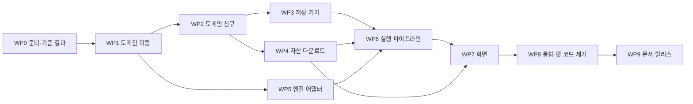

# 5단계 — 구현 계획 및 작업 분할 (google_stt 재작성 v4.0.0)

- 파일: `docs/AI_analyze/05_구현계획_작업분할_20261105.md`
- 작성: 2026-11-05 (Android Application 개발 공통 지침 2장 5단계)
- 입력: 4단계 설계(승인 2026-11-05, Q9~Q14 권장안 확정), 3단계 결정 D13~D21
- 범위: 작업 단위 정의, 작업 패키지(WP)·작업(Task) 목록, 순서·의존, 검증 지점, 라이브러리 판 고정, 기준 결과(회귀 비교용) 확보 방법.
- 범위 밖: 테스트 케이스 상세·오류 처리 표(6단계), 코드(7단계).

---

## 0. 4단계 승인으로 확정된 결정(누적)
| 번호 | 결정 |
|---|---|
| D22 | Gradle 모듈 `:app` 하나 + 패키지 계층(Q9) |
| D23 | 의존성 주입은 `AppContainer` 수동(Q10) |
| D24 | 패키지 이름 `com.example.google_stt` 유지, versionName 4.0.0 / versionCode 12(Q11) |
| D25 | 화면 전환은 탭 3개 상태 전환, navigation-compose 미사용(Q12) |
| D26 | 스트리밍·Vosk 에서 Feed 를 고른 경우만 조건 이름 끝에 `_FEED_<이름>`(Q13) |
| D27 | `main` 에 `v3.0.0` 태그 → `v4-rewrite` 브랜치에서 작업 → 8단계 통과 후 병합(Q14) |

---

## 1. 작업 단위 정의 (꼬리 질문 답)

**두 단계로 나눈다: 기능 단위 = 작업 패키지(WP), 커밋 단위 = 작업(Task).**

| 단위 | 정의 | 크기 기준 | 끝났다고 보는 조건 |
|---|---|---|---|
| **WP(기능 단위)** | 사용자가 확인할 수 있는 기능 묶음. 끝에 검증 지점(마일스톤)이 있다 | 작업 3~8개 | WP 검증 항목 통과(단위 테스트 묶음·실기기 확인) |
| **Task(커밋 단위)** | 목적 하나, 커밋 하나. 리뷰 한 번에 읽을 수 있는 크기 | 파일 1~5개, **바뀐 줄 400줄 이하**(옮기기만 한 줄 제외). 크기 표기 S ≤150줄 · M 150~400줄. 400줄을 넘으면 나눈다 | ① `assembleDebug` 성공 ② `testDebugUnitTest` 통과 ③ 해당 Task 의 검증 항목 통과 ④ 기존 앱(v3 화면)이 계속 빌드됨 |

- **항상 빌드되는 상태 유지**: 새 구조를 옆에 세우고(신규 패키지), 마지막 WP8 에서 화면을 갈아 끼운 뒤 옛 코드를 지운다. 중간 커밋 어디서든 앱이 설치·실행된다.
- **옮기기와 고치기를 다른 커밋으로**: `git mv`+패키지 선언만 바꾸는 커밋(이력 유지) → 내용 수정 커밋. Beyond Compare 로 볼 때 "옮김"과 "바뀜"이 섞이지 않는다.
- 커밋 메시지: `<종류>(<영역>): <요약> [T<번호>]` 예 `feat(domain): 조합 생성기 추가 [T2-4]`. 종류 = feat/fix/refactor/move/test/build/docs.
- 코드 안 표시: 신규 줄 `add-hyungchul-YYYYMMDD-HHMM`, 수정 줄 `change-hyungchul-YYYYMMDD-HHMM`. B 판정 파일은 원본의 함수·변수 순서를 유지(코드 규칙 2).
- 규모 추정: **WP 10개, Task 52개**. 신규·재작성 코드 약 9,000~11,000줄(현 12,221줄 중 A·B 약 6,500줄 재사용).

---

## 2. 라이브러리 판 고정
| 항목 | 판 | 근거 |
|---|---|---|
| AGP | 9.3.1(현행 유지) | 3단계 T1 |
| Kotlin(KGP)·Compose 컴파일러 플러그인 | 2.4.21 | Kotlin 릴리스(2026-10-08) |
| compileSdk / targetSdk / minSdk | 37 / 35 / 31 | D20 |
| Compose BOM | 2026.09.00 (ui·foundation 1.12.1, material3 1.4.0) | BOM 매핑 |
| activity-compose | 1.13.0 (2026-03-11 안정판) | androidx activity 릴리스 |
| lifecycle-viewmodel-compose / lifecycle-runtime-compose | 2.11.0 (2026-06-17) — Compose compileSdk 37 → AGP 9.2.0 이상 요구, 충족 | androidx lifecycle 릴리스 |
| datastore-preferences | 1.3.0 (2026-10-21) | androidx datastore 릴리스 |
| commons-compress | 1.28.0 (+ codec 1.19.0, io 2.20.0, lang3 3.18.0 전이) | Maven POM |
| kotlinx-coroutines-android | 1.9.0 → **1.11.0**(최신 안정판). T0-2 에서 `./gradlew :app:dependencies` 로 실제 해석 판 확인 후 확정 | coroutines 릴리스 |
| 유지 | sherpa-onnx 정적 AAR 1.13.8, onnxruntime-android 1.25.1, vosk-android 0.3.75, jna 5.18.1@aar, mlkit genai-speech-recognition 1.0.0-alpha1, documentfile 1.0.1, junit 4.13.2 | D19, 1단계 |
| 삭제(WP8) | appcompat, material(View), constraintlayout, activity-ktx | 4단계 8장 |

---

## 3. 작업 패키지 개요와 순서

| WP | 이름 | Task 수 | 마일스톤(검증 지점) | 실행 위치 |
|---|---|---|---|---|
| WP0 | 준비·기준 결과 | 5 | M0: 새 설정으로 v3 앱 빌드·실행, 기준 TXT 확보 | PC3 + S24 |
| WP1 | 도메인·엔진 파일 이동(A) | 5 | — (빌드 유지) | PC3 |
| WP2 | 순수 도메인 신규 | 9 | **M1: 도메인 단위 테스트 전부 통과** | PC3 |
| WP3 | 저장·설정·기기 계측 | 5 | — | PC3 + S24 |
| WP4 | 자산 다운로드·가져오기 | 7 | **M2: 앱이 모델 1개를 받아 해제·검증** | PC3 + S24 |
| WP5 | 엔진·VAD 어댑터 | 6 | — | PC3 |
| WP6 | 실행 파이프라인·서비스 | 7 | **M3: 계측 테스트로 작업 1개 종단 실행, 기준 TXT 와 동일** | S24 |
| WP7 | 화면(Compose) | 5 | — | PC3 + S24 |
| WP8 | 통합·옛 코드 제거 | 3 | **M4: 새 화면으로 kr/en 소규모 조합 완주** | S24 |
| WP9 | 문서·릴리스 준비 | 0(10단계에서 수행) | — | — |
| 합계 | | **52** | | |

- **실행 위치**: 이 대화(클라우드)는 빌드·실기기 불가 → **7단계 구현은 PC3 의 로컬 Claude Code** 에서 진행(3단계 부록 A-4). 5·6단계 문서까지 이 대화에서 완성하고, WP0 의 T0-3 에서 `CLAUDE.md` 를 만든다.

---

## 4. 작업 목록

표기: 크기 S/M, 의존(선행 Task), 검증(그 커밋에서 확인할 것).

### WP0 준비·기준 결과
| Task | 내용 | 파일 | 크기 | 의존 | 검증 |
|---|---|---|---|---|---|
| T0-1 | `main` 에 `v3.0.0` 태그, `v4-rewrite` 브랜치 생성 | (git) | S | — | `git tag`, `git branch` |
| T0-2 | 빌드 구성: buildscript KGP 2.4.21, compose 플러그인, compileSdk 37, `buildFeatures.compose`, 신규 의존성 추가(기존 의존성은 유지), versionCode 12·versionName `4.0.0-dev` | `build.gradle.kts`(최상위·app), `libs.versions.toml` | S | T0-1 | Sync·`assembleDebug`, 기존 v3 화면 실행 |
| T0-3 | `CLAUDE.md`(프로젝트 규칙·명령·문서 위치·금지 사항), `HANDOFF_20261105_v4.0.0-dev.md` | 루트 2파일 | S | T0-1 | `/context` 에서 CLAUDE.md 로드 확인 |
| T0-4 | 단위 테스트 기반: `app/src/test` 폴더, 예시 테스트 1개, `testDebugUnitTest` 동작 | test 1파일 | S | T0-2 | 테스트 1개 통과 |
| T0-5 | **기준 결과 확보**(코드 아님): v3.0.0 앱으로 작은 견본 실행 — kr `Customer_Service_KR/01`, en `Customer_Service_EN/01` × {whisper-base, qwen3asr-0.6b, zipformer-ko, sensevoice-small, nemotron3.5-560ms(Feed REALTIME), vosk-small-ko/en} × {NOVAD, SILERO, PYANNOTE_S500}. 결과 TXT 를 `docs/baseline_v3/` 에 보관 | (결과 파일) | S | — | 파일 존재 |

- T0-5 이유: 8단계 회귀에서 "같은 입력·모델·조건이면 오프라인 엔진 TXT 바이트 동일"(NFR-07)을 판정할 기준. 스트리밍은 Feed 가 달라지므로 v4 에서 같은 Feed(REALTIME)로 비교.

### WP1 도메인·엔진 파일 이동(판정 A, 내용 변경 없음)
| Task | 내용 | 크기 | 의존 | 검증 |
|---|---|---|---|---|
| T1-1 | `VadConfig/VadSegment/VadResult` 를 `SileroVadProcessor.kt` 에서 `domain/vad/VadTypes.kt` 로 분리, import 정리 | S | T0-2 | 빌드 |
| T1-2 | `git mv`: `vad/VadModels·FrameSegmenter·SegmentPacker·KaldiFbank` → `domain/vad/` | S | T1-1 | 빌드 |
| T1-3 | `git mv`: `SpeechEpd` → `domain/epd/`, `AudioDecoder` → `engine/audio/`, `denoise/*` → `engine/denoise/` | S | T0-2 | 빌드 |
| T1-4 | `git mv`: `stt/PcmFeeder·SttConstants·SttUtil` → `engine/stt/` | S | T0-2 | 빌드 |
| T1-5 | 이동 파일 단위 테스트: `SegmentPacker`(ENGINE_MAX·SEG10 조각 수), `FrameSegmenter`(Silero 규칙), `VadModels.conditionToken`(CUSTOM 이름) | M | T1-2, T0-4 | 테스트 통과 |

### WP2 순수 도메인 신규
| Task | 내용 | 파일 | 크기 | 의존 | 검증 |
|---|---|---|---|---|---|
| T2-1 | `Language`, `LangSupport`, `Runtime`, `Commercial`, `ModelSpec`, `AssetSpec`, `AssetFile` | `domain/catalog/*` | S | T1-2 | 빌드 |
| T2-2 | `Catalog`: 모델 20개·자산(STT 16 + Vosk 2 + VAD 5) — 값은 `SherpaModels.kt`·`SttModels.kt`·3단계 용량표에서 옮김. `asset_manifest.json` 읽기(해시 합치기) | `Catalog.kt`, `assets/asset_manifest.json` | M | T2-1 | 테스트: 엔진 이름에 `_` 없음, KO/EN_ONLY 집합이 기존 PlanCheck 와 같음 |
| T2-3 | `LanguageResolver` + `LangPlan`(서버 `INPUT_LANG_WORDS` 규칙, 루트 판정, 기억 값 반영) | `domain/lang/*` | S | T2-1 | 테스트: `en`/`kr`/`Customer_Service_KR`/`misc`/루트 `kr` |
| T2-4 | `RunOptions`, `FeedChoice`, `SegMode`, `ConditionName`(D26 Feed 토큰 포함) | `domain/condition/*` | S | T1-2 | 테스트: 기존 조건 이름과 같음, Feed 토큰 규칙 |
| T2-5 | `Job`, `ComboGenerator`(언어 전용 제외·ML Kit Feed 제한·순서 규칙) | `domain/plan/Job.kt`, `ComboGenerator.kt` | M | T2-2~4 | 테스트: 616개, 제외 내역, 순서 |
| T2-6 | `PlanCsv`(기존 형식 입출력), `PlanProgress`(`_plan_progress.csv`) — `PlanModels.kt` 에서 이식 | `domain/plan/*` | M | T2-5 | 테스트: 기존 견본 `plan_kr_en_app_REALTIME_VAD22.csv` 읽어 같은 조합 |
| T2-7 | `CsvColumn`, `CsvFormat`(따옴표·utf-8-sig), `FileRecord` | `domain/csv/*` | S | T2-1 | 테스트: 쉼표·따옴표·줄바꿈 값 |
| T2-8 | `UnifiedCsv`(74열, 2단계 6장 매핑), `DeviceCsv`(4단계 7-3), `RunMeta` | `domain/csv/*` | M | T2-7 | **골든 테스트: 74열 이름이 서버 `STT_CSV_HEADER` 사본과 같음**, 행 열 수 = 74 |
| T2-9 | `EtaEstimator`, `RtfKey`, `RtfSource` | `domain/eta/*` | S | T2-5 | 테스트: 출처 우선순위, 다른 기기 값 합계 제외 |

**M1**: `testDebugUnitTest` 전부 통과, `domain` 패키지에 `android.` import 0건(grep).

### WP3 저장·설정·기기 계측
| Task | 내용 | 크기 | 의존 | 검증 |
|---|---|---|---|---|
| T3-1 | `SafTree`(자식 목록 캐시, 폴더 만들기, 원자적 쓰기 4단계, `.tmp` 복구) | M | T0-2 | 계측 테스트(S24): 쓰기·덮어쓰기·tmp 복구 |
| T3-2 | `OutputLayout`(경로 규칙, `_` 접두어, `_stale_`), `AudioScanner`(재귀 수집·확장자) | M | T3-1, T2-3 | 단위 테스트(경로 문자열) + 실기기 54개 수집 |
| T3-3 | `ResultWriter`(TXT·result·device·run_meta·summary, 10파일마다 다시 쓰기) | M | T3-1, T2-8 | 계측 테스트: CSV 74열·BOM |
| T3-4 | `SettingsRepository`, `LangMemoryRepository`, `RtfRepository`(DataStore) | M | T2-9 | 계측 테스트: 저장·복원 |
| T3-5 | `DeviceProbe`(배터리·발열·headroom·PSS·CPU time·네트워크 delta·deviceKey), `AppLog`(20 MB 회전) — `SttTelemetry` 기기 조회 부분 이식 | M | T0-2 | 실기기 로그 값 확인 |

### WP4 자산 다운로드·가져오기
| Task | 내용 | 크기 | 의존 | 검증 |
|---|---|---|---|---|
| T4-1 | `AssetStore`(앱 전용 경로, `.ready`, 여유 공간), `Sha256` | S | T2-1 | 단위 테스트(해시) |
| T4-2 | `AssetDownloader`(Range 이어받기·원래 URL 재요청·3회 재시도·TLS 분류) | M | T4-1 | 실기기: 받는 중 비행기 모드 켜고 끄기 → 이어받기 |
| T4-3 | `ArchiveExtractor`(tar.bz2·zip, 필요한 파일만, `..` 경로 차단) | M | T4-1 | 단위 테스트(작은 견본 압축 파일) + 실기기 whisper-base |
| T4-4 | `AssetImporter`(SAF 폴더 → 복사 → SHA256) | S | T4-1 | 실기기: PC 에서 옮긴 폴더 가져오기 |
| T4-5 | `AssetRepository`(상태 Flow, `ensureReady`, 필요 용량, 작은 것부터 받기) | M | T4-2~4 | 단위 테스트(상태 전이, 가짜 다운로더) |
| T4-6 | PC 스크립트 `tools/fetch_assets.py`(받기·해시 계산·`asset_manifest.json` 생성·B 방법용 해제 폴더 만들기). 기존 `download_*.sh` URL 재사용 | M | T2-2 | PC 실행 → 매니페스트 생성 |
| T4-7 | RunService "다운로드 모드" 최소판(포그라운드 알림만, 실행 기능 없음) | S | T4-5 | 화면 꺼도 다운로드 계속 |

**M2**: 앱이 whisper-base 를 받아 해제·SHA256 검증 후 `.ready`, PC 가져오기도 성공. 회사망 Wi‑Fi 에서 TLS 오류 안내 문구 확인(가능하면).

### WP5 엔진·VAD 어댑터
| Task | 내용 | 크기 | 의존 | 검증 |
|---|---|---|---|---|
| T5-1 | `SttEngineAdapter` 계약·`AudioChunk`·`LoadInfo`(기존 `StreamingSttTranscriber` 확장), `SttAdapterFactory` | S | T2-1, T1-4 | 빌드 |
| T5-2 | `SherpaOfflineAdapter`: `git mv` 커밋 + 수정 커밋(모델 폴더 주입, `ensureActive`) | M | T5-1 | 계측 테스트: whisper-base 1파일, 기준 TXT 동일 |
| T5-3 | `SherpaStreamingAdapter`: 이동 + 수정(`delay()`, Feed NONE=최대 속도) | M | T5-1 | 계측: nemotron REALTIME 기준 TXT 동일, NONE 동작 |
| T5-4 | `VoskAdapter`: 이동 + 수정 | S | T5-1 | 계측: vosk-ko 1파일 |
| T5-5 | `MlKitAdapter` + `GoogleSttSession`: 이동 + 수정(Context 의존 정리, 세션 한도 규칙 유지) | M | T5-1 | 실기기: 1파일 전사 |
| T5-6 | VAD: `VadPipeline`·디텍터 5종 이동 + `VadDetectorFactory` 경로 주입 | M | T1-1, T4-1 | 계측: 5종 각각 구간 수가 v3 와 같음 |

### WP6 실행 파이프라인·서비스
| Task | 내용 | 크기 | 의존 | 검증 |
|---|---|---|---|---|
| T6-1 | `PipelineSteps`(decode/denoise/vad/pack/epd/transcribe/record) — `BatchRunner` 결정 규칙 이식, 취소 규칙 | M | WP5, T3-3 | 단위 테스트(가짜 어댑터로 단계 순서·시간 기록) |
| T6-2 | `JobPipeline`(모델 적재 1회·파일 반복·ERROR 행·엔진 먹통 판정·폴더 이름 바꾸기) | M | T6-1 | **계측 테스트: whisper-base × SILERO × kr 01 종단 실행, 기준 TXT 동일, CSV 74열** |
| T6-3 | `ThermalGate`, `MemLogger` | S | T3-5 | 단위 테스트(가짜 발열 값) |
| T6-4 | `ResumeManager`(진행 기록·꺼진 이유·SKIPPED·`_stale_`) | M | T2-6, T3-2 | 계측: 강제 종료 후 이어 하기 |
| T6-5 | `JobScheduler`(슬롯·오프라인/ML Kit Mutex·자산 대기·중지 2종) | M | T6-2~4, T4-5 | 단위 테스트(가짜 파이프라인: 동시 수·순서·중지 5초) |
| T6-6 | `RunState`, `RunController`, `RunService`(specialUse·wake lock·알림·중지 버튼), Manifest 권한 | M | T6-5, T4-7 | 실기기: 화면 끄고 30분 실행 |
| T6-7 | `AppContainer`, `SttApp` | S | T6-6 | 빌드 |

**M3**: 계측 테스트로 엔진 4종 × VAD 2종 소규모 실행, 오프라인 엔진 TXT 가 기준(T0-5)과 바이트 동일.

### WP7 화면(Compose)
| Task | 내용 | 크기 | 의존 | 검증 |
|---|---|---|---|---|
| T7-1 | 테마(라이트/다크), `AppRoot` 하단 탭, 공용 컴포넌트(FolderCard·ChipGroup·SummaryCard·LogList) | M | T0-2 | 미리보기·실기기 |
| T7-2 | 설정 탭 + `SetupViewModel`(폴더 선택·언어 판정·칩 선택·고급·요약·조합 CSV) | M | WP2, T3-4, T6-7 | 실기기: scarlett 선택 → kr/en 자동 |
| T7-3 | 실행 탭 + `DashboardViewModel` | M | T6-6 | 실기기: 진행·남은 시간·로그 |
| T7-4 | 모델 탭 + `ModelsViewModel` | M | T4-5 | 실기기: 받기·삭제·가져오기 |
| T7-5 | 대화창 5종(이어 하기·언어 선택·시작 전 점검·다운로드 확인·중지) | M | T7-2, T6-4 | 실기기: 각 대화창 흐름 |

### WP8 통합·옛 코드 제거
| Task | 내용 | 크기 | 의존 | 검증 |
|---|---|---|---|---|
| T8-1 | `MainActivity` 를 Compose 진입점으로 교체, 테마·Manifest 정리(`MANAGE_EXTERNAL_STORAGE` 삭제) | M | WP7 | 실기기 실행 |
| T8-2 | 옛 코드 삭제: `batch/`, `plan/PlanRunner·PlanState`, `ui/VadUi…UiUtils`, `res/layout/*`, `io/ResultStore`, `SttTelemetry`, 남은 `stt/*Transcriber` | M(삭제 위주) | T8-1 | 빌드·단위·계측 테스트 전부 통과 |
| T8-3 | 의존성 정리(appcompat·material·constraintlayout·activity-ktx 삭제), versionName `4.0.0` | S | T8-2 | APK 크기·빌드 |

**M4**: 새 화면으로 kr/en × 모델 6종 × VAD 3종(36조합) 완주, 결과 폴더·CSV 를 PC 평가기(`run_eval.py`)로 읽기 확인 → 8단계로.

### WP9 문서·릴리스(10단계에서 수행)
- README.md, `RELEASE_NOTES_v4.0.0`(MD + docx), `HANDOFF_<날짜>_v4.0.0.md`, `STT_계측_CSV_설명서.md` 갱신(74열 + device.csv).

---

## 5. 진행 방식
1. Task 하나 = 커밋 하나. 시작 전 `CLAUDE.md` 규칙 확인 → 구현 → 빌드 → 단위 테스트 → (해당 시) 실기기 → 커밋.
2. WP 끝마다 사용자 검토(마일스톤 보고: 한 일·검증 결과·남은 문제). M1~M4 는 사용자 승인 후 다음 WP.
3. push 는 사용자 확인 후(T0-1 부터 동일).
4. 문제 발견 시 해당 Task 를 나누거나 새 Task(`T<WP>-<n>a`)를 추가하고 이 문서를 갱신.

## 6. 위험과 일정 영향
| 위험 | 영향 Task | 대응 |
|---|---|---|
| Kotlin 2.4.21 + AGP 9.3.1 Sync 문제 | T0-2 | KGP 2.3.21 로 내림(3단계 대체안) |
| SAF 이름 바꾸기 미지원 | T3-1 | 삭제 후 새로 쓰기 대체 + 경고 |
| sherpa 경로 주입 후 모델 로드 실패 | T5-2 | 실기기 로그로 경로·권한 확인, 앱 전용 경로 문제면 내부 저장소(`filesDir`) 대안 |
| 기준 TXT 와 불일치 | T5-2·T6-2 | 디코딩·VAD·조각 경계부터 단계별 비교(PCM 해시·구간 목록 덤프) |
| 대량 다운로드 시간 | M2 | B 방법(PC 해제 후 가져오기)로 진행 |

---

## 7. 6단계로 넘길 항목
- Task 별 검증 항목을 테스트 ID 로 구체화(단위·계측·실기기 수동), 오류 처리 표(다운로드·SAF·엔진·서비스·발열·메모리), 8단계 회귀 시험 목록.

## 출처
- androidx activity 릴리스: https://developer.android.com/jetpack/androidx/releases/activity
- androidx lifecycle 릴리스: https://developer.android.com/jetpack/androidx/releases/lifecycle
- androidx datastore 릴리스: https://developer.android.com/jetpack/androidx/releases/datastore
- kotlinx.coroutines 릴리스: https://github.com/Kotlin/kotlinx.coroutines/releases
- Kotlin 릴리스: https://kotlinlang.org/docs/releases.html
- Compose BOM 매핑: https://developer.android.com/develop/ui/compose/bom/bom-mapping
- Commons Compress 1.28.0 POM: https://repo1.maven.org/maven2/org/apache/commons/commons-compress/1.28.0/commons-compress-1.28.0.pom
